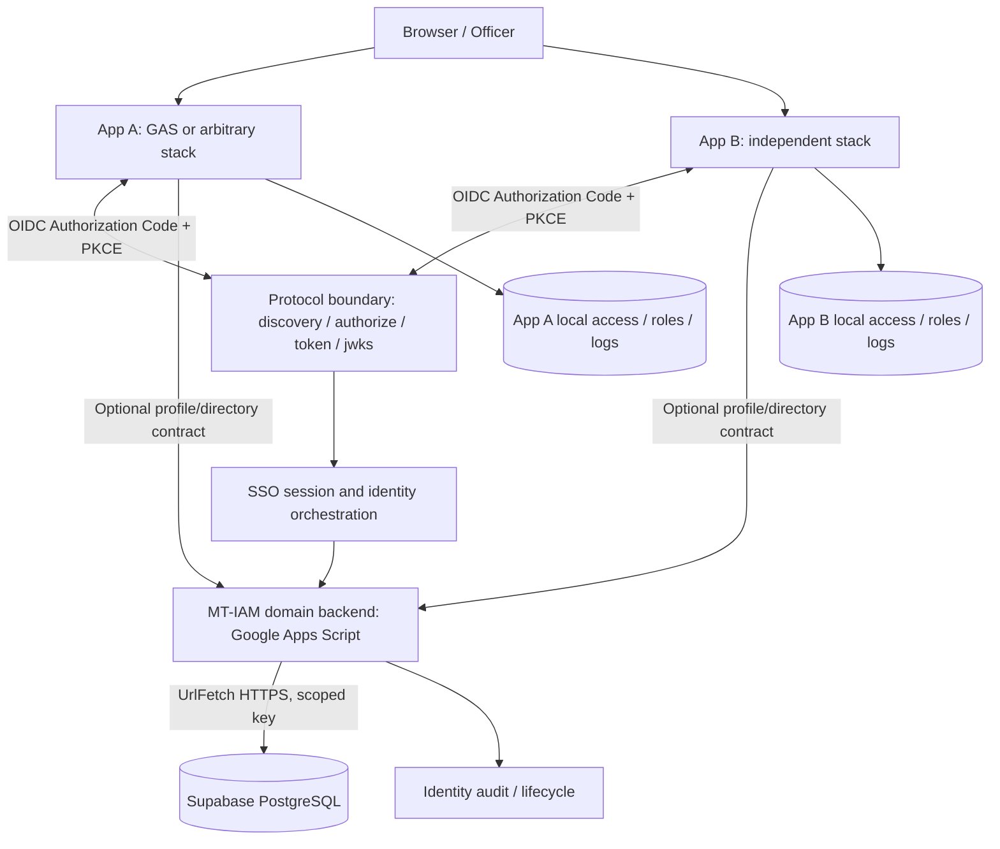

# MT-IAM Detailed Architecture v0.2
Status: **Approved brief / proposed detailed design; security R3; not production approved**. Date: 2026-11-13. SSOT: idev006/MT-I-AM.

## 1. Goals and invariants
MT-IAM is the identity control plane for independent applications. User expectation: authenticate once, enter subsequent apps without another password prompt while an eligible central session remains valid. App developers may choose any programming language, deployment, database, user access mechanism and business logic. MT-IAM is the shared identity/personnel-directory SSOT and client trust registry; **applications decide app admission and all internal authorization**.

### In scope
Central user identity and account lifecycle; minimal shared personnel attributes; centralized login/SSO; interoperable OIDC protocol surface; app-client onboarding; directory/profile APIs; identity security events; revocation and operations.
### Out of scope
Centralized per-app role or permission database; application business data; routing every business request through MT-IAM; logging all application events; changing applications' deployment model.

## 2. Container view (logical, not deployment proof)

**Decision boundary**: GAS remains the primary domain/business backend and Supabase is primary storage. GAS Web Apps cannot independently promise general-purpose Set-Cookie, headers, redirects or HTTP status controls needed by a standard OIDC provider. The protocol boundary above is an **architectural requirement, not an implemented endpoint**. See ADR-002/003 and POC-01. No claim that GAS alone is OIDC-conformant.

## 3. Trust zones
1. Public browser: hostile; never trusted as source of user identity, roles, or client secrets.
2. Independent app: autonomous administrator; must validate issuer, audience, signature, expiry, nonce/state, app access and resource permissions.
3. Identity protocol surface: security boundary; exact redirect URIs, PKCE S256, one-time codes, per-client tokens, secure first-party session cookies and logout/revocation.
4. GAS domain services: private authenticated machine boundary, not callable merely because its script URL is obscure.
5. Supabase PostgreSQL: restricted schema and service credentials held only in controlled backend; no browser service_role access.

## 4. End-to-end interactions
### First sign-in to App A
- App A registers OIDC client with callback URI and requested scopes.
- A initiates Authorization Code + PKCE; state, nonce and S256 verifier generated securely.
- Browser performs top-level navigation to IAM issuer; subject authenticates and establishes central server-managed SSO session.
- IAM returns short-lived one-time authorization code only to registered callback.
- A exchanges code with PKCE and validates ID token, including issuer/audience/nonce; establishes an app-local session.
- A looks up its own admission/roles, and rejects unauthorized users regardless of successful identity proof.

### Visit App B
- B initiates **its own** authorization request/client. Existing valid central SSO session avoids repeated credential entry, subject to policy and reauthentication triggers.
- B receives tokens **for B**, validates independently, and checks its own admission. Tokens minted for A must never be accepted by B.

### Session expiration and account suspension
- Central session and local app sessions have independent lifetimes; no permanent "remember me".
- Suspension blocks subsequent authorizations and must propagate to existing app sessions through an explicit bounded protocol (short local expiry + revalidation or approved back-channel signal). No instant global logout claim.
- App business API enforcement is local; business operations do not make unconditional synchronous calls to MT-IAM.

## 5. Availability and performance
- Central IAM primarily sees authentication, renewal, client registration and requested directory reads—not every business action.
- Directory attributes can be cached with a defined TTL, version and data-minimization policy; high-risk suspension must respect a tighter bound.
- GAS quotas, UrlFetch behavior, Supabase limits and cold starts are measurable constraints; do not assert 100+ app capacity without load evidence.
- POC measures P50/P95 for first sign-in, cross-app SSO, server-side profile, auth failure, and revocation under representative concurrency.
- Fallback when IAM unreachable: an app may continue a previously validated local session only within its documented risk-based lifetime; never grant new privileges without validated identity.

## 6. Data governance and privacy
- Stable keys: opaque person_id, user_id, external identity pair (issuer, subject).
- Profile fields have lawful purpose, source_system, classification, ownership, retention and change history.
- Distinguish IAM identity SSOT from authoritative HR upstream source where available.
- No real personnel data, keys or screenshots with personal information in a public GitHub repository.
- Separate operational audit from request/debug logs. Redact tokens/passwords.

## 7. Deployment and portability
Proposed stacks: Google Apps Script V8 (domain endpoints); Supabase PostgreSQL (portable SQL migration through PostgreSQL tooling); Vue/Vite static UI; possible narrow portable OIDC protocol adapter **only if required by POC**. Keep OIDC contracts independent of Supabase and GAS; export/import data and keys with controlled secret handling; plan issuer URL transition explicitly. GitHub repository stores sanitized architecture and automation only.

## 8. Observability / operations
Structured identity events with event_id, correlation_id, timestamp UTC, actor/sub, client_id, event_type, outcome, policy version. Track auth latency, failed logins, revocation propagation, errors, rate limit, quota exhaustion. Maintain restore drills, incident escalation and key rotation runbooks.

## 9. Open decisions
- Architecture of standards-capable OIDC protocol surface and session cookies: **BLOCKED pending POC**.
- Domain/TLS deployment, signing keys and safe secret custody: **BLOCKED**.
- Account recovery, MFA policy, HR authoritative sources, consent/legal bases and retention schedule: **DESIGN REQUIRED**.
- Endpoint contractual details are proposals until security conformance.

## 10. Architecture acceptance
G1: scope boundaries documented, security threat model reviewed, OIDC profile and API contract versioned, Data Model and ADRs linked. G2: two independent applications successfully share central SSO while independently refusing application admission; negative token tests; repeat-login, revocation, outage and latency evidence. Production release requires later hardening and operational gates.
