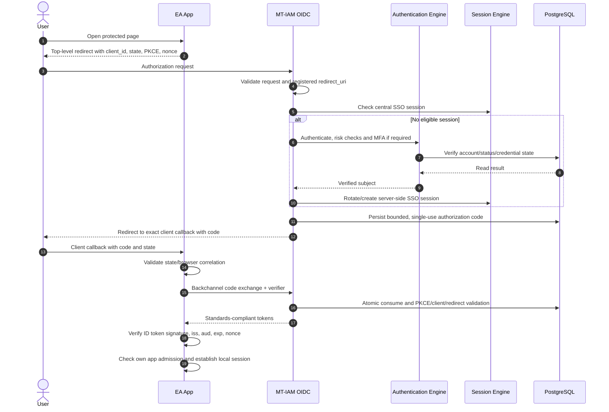
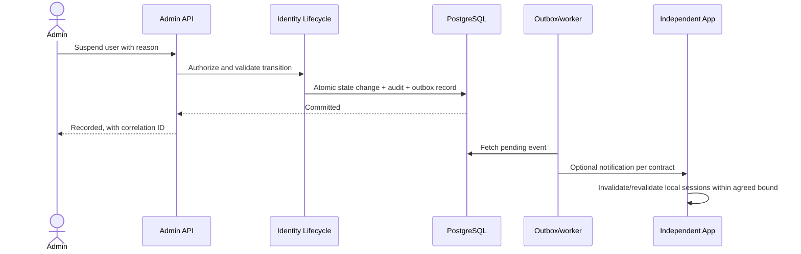
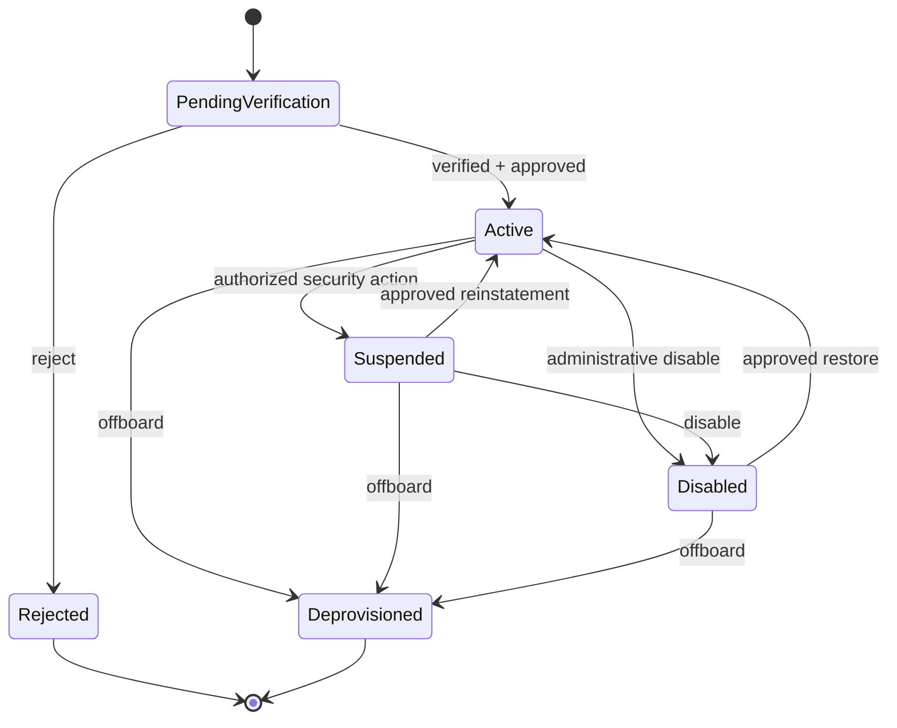

# MT-IAM System Models v0.5 — Actors, Use Cases, API, States and Sequences

**Status: PROPOSED detailed design; not implemented or tested. Risk R3.** 2026-11-13. Refer to [target architecture](TARGET_ARCHITECTURE_v0.5_PYTHON_FIRST.md).

## Cross-model traceability rule
Each R3 feature requires `ACT -> UC -> BR -> DOM/STM -> SEQ -> API -> TEST -> recorded evidence`. Design IDs are stable, not API identifiers. The mappings below are initial proposals for review, not claims of exhaustiveness.

## Actors and trust boundaries
| Actor | Responsibility / trust note |
|---|---|
| ACT-01 End User | Signs in; has no automatic admission to EA apps |
| ACT-02 Organization Admin | Manages scoped personnel/organization records |
| ACT-03 IAM Admin | Manages identity/account status within delegated authority |
| ACT-04 Security Officer | Reviews risk events, suspension decisions, key lifecycle |
| ACT-05 Application Owner | Requests and manages own registered clients |
| ACT-06 OIDC Client App | Authenticates via OIDC, manages its own local session |
| ACT-07 Resource Server | Validates authorized API access independent of UI |
| ACT-08 Directory Integrator | Imports/updates authorized source identity data |
| ACT-09 Auditor | Read-only scoped identity audit |
| ACT-10 Platform Operator | Deploys, monitors, operates cloud infrastructure |
| ACT-11 Automated Worker | Executes scoped, idempotent queued jobs |
| ACT-12 Identity Verifier | Confirms enrollment evidence through approved process |

Actor is not necessarily a platform role. Enforce least privilege, separation of duties, per-organization scope, reauthentication for privileged commands and no universal superuser assumption.

## Use-case registry
| UC | Actor(s) | Outcome | Critical rules / models |
|---|---|---|---|
| UC-AUTH-001 | 01,06 | First application login | BR-001/002; SEQ-001; STM-SESSION, STM-CODE |
| UC-AUTH-002 | 01,06 | Cross-app SSO without retyping password when eligible | BR-001/003; SEQ-002 |
| UC-AUTH-003 | 01 | Logout/session termination | BR-004; STM-SESSION |
| UC-AUTH-004 | 01,12 | Recovery/change authentication factor | BR-005; security review |
| UC-ID-001 | 02,12 | Enroll/verify identity | BR-006; STM-ACCOUNT |
| UC-ID-002 | 02 | Move personnel / update organization assignment | BR-007; STM-ACCOUNT |
| UC-ID-003 | 03,04 | Suspend/re-enable/deprovision account | BR-003/008; STM-ACCOUNT; SEQ-003 |
| UC-CLIENT-001 | 05,03 | Register/approve OIDC client | BR-009; STM-CLIENT |
| UC-CLIENT-002 | 05,03 | Change exact redirect URI / rotate client secret | BR-009/010; STM-CLIENT |
| UC-API-001 | 06 | Single-use authorization code exchange | BR-001/002; STM-CODE; SEQ-001 |
| UC-API-002 | 07 | Validate access token for designated resource | BR-011; API-resource |
| UC-SEC-001 | 04,10 | Signing-key rotation | BR-012; STM-KEY |
| UC-AUD-001 | 09 | Read sanitized, scoped audit trail | BR-013 |
| UC-INT-001 | 08,11 | Import records idempotently with provenance | BR-014; STM-JOB |
| UC-OPS-001 | 10 | Health, alerts, backup/restore verification | BR-015; resource gates |

## Business rules (normative draft)
- BR-001 OIDC authorization-code + PKCE S256; exact registered redirect URIs; validated state/nonce when applicable; no implicit/password grant.
- BR-002 Codes short lived, one-time **atomic consume**; client binding and PKCE verifier match; fail closed on replay.
- BR-003 A valid central SSO session may avoid password re-entry; app-local admission always checked; account suspension blocks new grants and has an explicitly tested propagation bound for existing local app sessions.
- BR-004 Secure, HttpOnly, appropriately SameSite/CSRF protected server sessions; local app logout and central/global logout semantics separately documented; no claim of instant universal logout.
- BR-005 Recovery and MFA enrollment require independent identity verification and secure anti-enumeration controls; never place recovery tokens in logs.
- BR-006 Source provenance, duplicate-person detection, mandatory approval for high-trust enrollment.
- BR-007 Organization assignments are time-bound and auditable; business app roles do not migrate into IAM.
- BR-008 Account-state transitions require actor scope, reason, authorization and durable audit; session/token revocation on disable according to approved policy.
- BR-009 Per-client owner, public/confidential classification, exact callbacks, appropriate credentials and approved scopes.
- BR-010 Client secret rotation supports overlap where necessary and audit of changes.
- BR-011 Resource servers verify relevant token issuer, audience, expiry, signature (or introspection per profile), not ID tokens as API access tokens.
- BR-012 Signing keys private, rotated with overlapping JWKS validity and incident recovery procedure.
- BR-013 Minimize PII in claims/logs; audit integrity, retention, access and legal-basis review.
- BR-014 Imports idempotent; conflicts and source authority resolved explicitly, no silent overwrites.
- BR-015 Fixed-size pools, timeouts, graceful shutdown, bounded retries; never treat budget alerts as spending caps.

## API exposure and groups
| Group | Prefix / endpoints (illustrative) | Exposure / authorization |
|---|---|---|
| API-OIDC | `/.well-known/openid-configuration`, `/authorize`, `/token`, `/jwks`; conditional `/userinfo`, `/revoke`, `/logout` | Public protocol, spec-defined responses, CSRF/cookie/code policies |
| API-ID | `/api/v1/identities`, `/api/v1/accounts` | Privileged and scope-limited |
| API-ORG | `/api/v1/organizations`, `/api/v1/personnel` | Organization-admin grants, data minimization |
| API-CLIENT | `/api/v1/clients` | App owner + approval for sensitive mutations |
| API-SESSION | `/api/v1/sessions` | User/self or appropriately privileged security roles |
| API-POLICY | `/api/v1/security-policies` | Restricted administrators; two-person controls where required |
| API-AUDIT | `/api/v1/audit-events` | Read-only scoped auditor; no raw credentials |
| API-DIR | `/api/v1/directory/... ` | Scoped machine clients; minimization/pagination |
| API-OPS | `/health/live`, `/health/ready`, telemetry | Internal/limited; avoid exposing secrets/config |

For every API: ownership, version, OpenAPI schema, authn/authz policy, redacted logging, typed errors, rate limits, pagination and idempotency policy, deprecation and contract tests. API groups are preliminary, not deployed routes.

## Sequence diagrams
### SEQ-001 initial sign-in (simplified; detailed browser/cookie and failures to test)


### SEQ-002 cross-app SSO and local denial
```mermaid
sequenceDiagram
  actor User
  participant B as App B
  participant IAM as MT-IAM issuer
  participant S as Session Engine
  User->>B: Open B
  B-->>User: New OIDC authorization redirect
  User->>IAM: Browser top-level navigation
  IAM->>S: Check eligible first-party central session
  S-->>IAM: Existing authenticated subject
  IAM-->>User: New client-B-bound authorization code
  User->>B: Callback
  B->>IAM: Exchange code + PKCE
  IAM-->>B: Client-B tokens
  B->>B: Verify claims and local admission
  alt B member
    B-->>User: Access granted
  else Not B member
    B-->>User: B access denied; A session unaffected
  end
```

### SEQ-003 account suspension and propagation

Notification is not presumed instant or guaranteed without consumer acknowledgment and tested retry behavior.

## State machines (proposed logical models)
### STM-ACCOUNT

### STM-CLIENT
`Draft -> PendingApproval -> Active -> Suspended/Revoked`; reactivation requires authorization and checks; Revoked terminal unless explicit fresh registration policy.
### STM-SESSION
`Active -> Expired/Revoked`; refresh/rotation and last-activity rules separate; expiration derived from time, not only stored enum.
### STM-CODE
`Issued -> Consumed` **atomic once** or `Issued -> Expired/Revoked`; no transition back.
### STM-REFRESH-FAMILY
`Active -> Rotated/Revoked/Compromised`; reuse triggers family revocation under policy and concurrent tests.
### STM-KEY
`Prepared -> Published -> Active -> Retiring -> Retired` with overlap, emergency compromise route and tested verification continuity.
### STM-JOB
`Queued -> Running -> Succeeded/Failed/Cancelled`; retries with bounded attempt count and durable idempotency key.

All transitions require event, authorized actor, guard, side effects, audit, concurrency behavior and error contract. Diagram arrows alone do not implement these controls.

## Pipeline catalog
- PIPE-REQ: rate-limit, parse/validate, authenticate, authorize, unit-of-work, response and telemetry; ordering may vary per protocol route and must be tested.
- PIPE-WORKFLOW: command -> orchestrator -> domain invariants -> atomic DB writes/outbox -> durable processing; bounded retries.
- PIPE-IMPORT: validation -> provenance -> identity matching -> review queue -> transactional commit -> audit.
- PIPE-DELIVERY: PR -> lint/types -> unit/contract -> DB integration -> security -> image build -> staging -> OIDC smoke/conformance -> release approval.
- PIPE-RECOVERY: detect outage -> limit new grants/fail securely -> alert -> recover DB/key/session -> verify evidence -> restore service.

## Traceability example
| Use case | Actor | Rules | Models/APIs | Test IDs (planned) |
|---|---|---|---|---|
| UC-AUTH-001 | ACT-01/06 | BR-001/002 | SEQ-001, STM-CODE, API-OIDC | T-AUTH-001..010 |
| UC-AUTH-002 | ACT-01/06 | BR-003 | SEQ-002, STM-SESSION | T-SSO-001..004 |
| UC-ID-003 | ACT-03/04 | BR-008 | SEQ-003, STM-ACCOUNT, API-ID | T-LIFE-001..007 |
| UC-CLIENT-001 | ACT-05/03 | BR-009 | STM-CLIENT, API-CLIENT | T-CLIENT-001..006 |
| UC-INT-001 | ACT-08/11 | BR-014 | STM-JOB, PIPE-IMPORT | T-IMPORT-001..006 |

## Open decisions and review checklist
Confirm actor scope/approval matrices; domain object constraints and schema; specific endpoint contracts; issuer/tenant model; whether MFA and external directory federation are in scope; retention schedules; token/session lifetimes; incident response and metrics. All are **OPEN**, not assumed implemented.

## Normative reference baseline
https://pages.nist.gov/800-63-4/
https://openid.net/specs/openid-connect-core-1_0.html
https://openid.net/specs/openid-connect-discovery-1_0.html
https://www.rfc-editor.org/rfc/rfc9700.html
https://www.rfc-editor.org/rfc/rfc7636.html
https://owasp.org/www-project-application-security-verification-standard/
