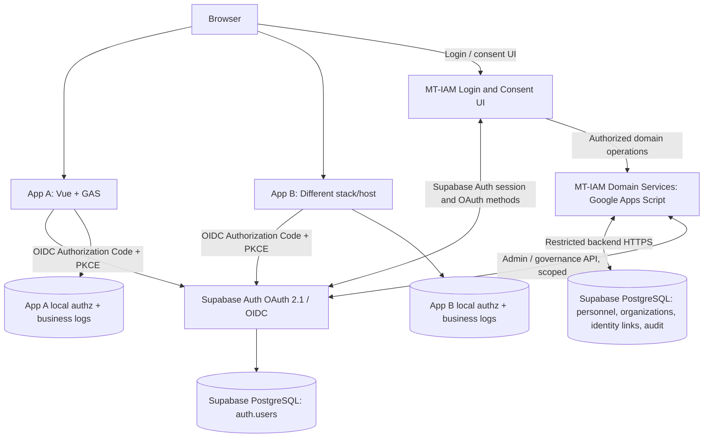

# MT-IAM Target Architecture v0.3 — GAS + Supabase Native OIDC
Date: 2026-11-13. Status: PROPOSED for engineering POC; not production-approved.

## Executive goal
Login once and traverse independent EA applications without repeated password prompts while the central identity session is eligible; preserve app-specific admission, roles, permissions, business rules, database, host and language.

## Decision summary
Use Google Apps Script (identity directory / personnel / governance business logic) + Supabase PostgreSQL (SSOT storage) + **Supabase Auth OAuth 2.1 Server / OIDC** (protocol engine). The login/consent frontend may use Vue + supabase-js. This avoids trying to make GAS ContentService behave like a fully standards-compliant authorization server.

## Container architecture

## Authentication sequence
1. App A initiates OIDC authorize with client_id, exact redirect_uri, openid scopes, state, PKCE S256 and nonce as appropriate.
2. Supabase Auth checks request and sends to configured MT-IAM authorization/login page.
3. Browser signs in through Supabase Auth if no valid session; otherwise user authentication is reused subject to policy.
4. MT-IAM UI inspects authorization details, enforces appropriate consent policy and approves/denies via documented supabase-js OAuth methods.
5. Supabase Auth redirects single-use authorization code to registered callback.
6. App A exchanges code and validates signed OIDC ID token and other evidence. App A checks its **own** user admission/roles and establishes app-local session.
7. App B later performs its own OAuth flow using another client_id and valid central session. Reuse does not mean copying A's token to B or skipping B's local authorization.
8. When no app permission exists, B rejects without affecting valid IAM/App A sessions.

## GAS scope
Use Apps Script for identity business workflows: person/organization records, assignments, reconciliation with upstream HR sources, directory projections, status requests, client governance dashboards and audit administration. Use UrlFetchApp with backend-only secrets, safeguarded external exposure and replay protection. Domain model must not treat Supabase auth role as the app's role.

## Supabase scope
Auth (native protocol), Postgres SSOT, controlled custom access token hooks only for minimal identity claims when required. Set asymmetric JWT signing keys before requesting OIDC ID tokens; validate issuer+subject mapping and audience with client library. Self-host feasibility is an exit plan, not demonstrated operational portability.

## Session model
Provider SSO session enables no-password repeat sign-ins. Every app holds its own local session and internal authorization. Avoid cross-site localStorage and shared client JWT. User account disabled -> deny new authorization; existing sessions require explicit policy and propagation tests. Do not assume global logout.

## Data ownership
auth.users (provider identity account), iam.persons, iam.user_account_links, iam.organizations, iam.person_assignments, iam.directory_changes, iam.client_governance, iam.identity_audit_events. App permissions live only in individual application databases. Person/user mapping must remain stable and migration aware; do not duplicate raw credentials.

## POC build and test order
P0-01 create isolated Supabase project; enable OAuth server beta; configure asymmetric keys; create test identities.
P0-02 register two test clients with exact callbacks and restricted scopes; install Vue login/consent UI.
P0-03 login App A; sign in App B without password; validate independent audience, client and subject.
P0-04 B rejects authenticated user with no app access while A remains accessible.
P0-05 expired/tampered/incorrect issuer and audience rejected; PKCE/state replay rejected.
P0-06 test refresh, session closure, logout, disabled account, outage and revocation boundedness; compare browsers.
P0-07 measure quotas, P50/P95 and validate basic portability/restore plan.
No claims of working SSO until recorded tests pass.

## Outstanding security design
Credential recovery, MFA, provider beta stability, disable-user semantics, signing-key custody/rotation, account-provision synchronization, consent and lawful personnel attributes, directory API access layer, hosting domains, refresh/session bound, exact client response behavior.

## Developer policy
Clients must follow published MT-ISP, OIDC discovery, exact redirect URIs, issuer+sub identity, audience/nonce validation and per-app backend authorization. No client may use Supabase service_role key or access IAM tables directly.
