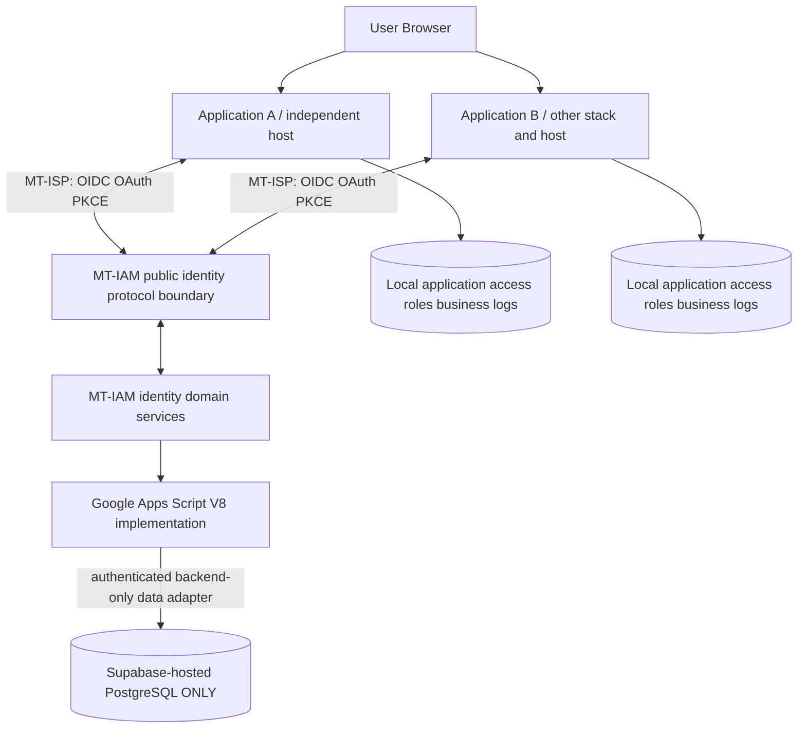

# MT-IAM Target Architecture v0.4 — Provider-Independent / GAS + PostgreSQL

**Status: Approved direction; detailed protocol implementation TBD.** Date 2026-11-13. Risk R3.
**Technology policy:** GAS primary domain backend; Supabase **database hosting only** (PostgreSQL). No Supabase Auth or native Supabase identity service.

## User outcomes
- One identity and a central sign-in experience; no repeated password prompts when switching between authorized EA apps with an eligible SSO session.
- Independent app rights: each app owns admission, roles/permissions, business rules, database, technology and hosting.
- Any app can implement MT-ISP; no app imports internal MT-IAM or Supabase-specific SDK as a required contract.
- Portable backend and data storage; avoid provider-specific auth primitives.

## Logical containers

**The protocol boundary is a required logical component, not evidence of an existing OIDC server.** Its physical runtime is OPEN. GAS cannot be assumed to produce required HTTP response headers, first-party cookies, redirects, key management or full OIDC semantics. Decide through POC-03; choose a small portable standards-compliant protocol runtime as needed. Avoid custom cryptography.

## Layer design
1. **Public MT-IAM Contract** — stable issuer, discovery, JWKS, authorization/token endpoints and versioned directory API. Must be owned by MT-IAM domain; issuer URL under a domain under organizational control.
2. **Identity Protocol Adapter** — HTTP/session/cookie/token controls, PKCE/code grants, signed ID token, key rotation and login/logout; implementation selection is blocked pending feasibility.
3. **Domain & Application Services (GAS)** — persons, accounts, organizations, source provenance, client registry governance, administrative commands, identity audit.
4. **Domain Ports** — abstract repositories/service interfaces for data and protocol operations; no provider-specific leakage into domain model.
5. **Data Infrastructure** — PostgreSQL domain schema hosted on Supabase; only standard storage capabilities relied on. Database access from GAS must be protected through an appropriate minimal access layer or narrow verified data API; do not treat Supabase's proprietary API as a permanent contract.
6. **Independent Clients** — OIDC standard integration, local app session and authorization. No centralized role/permission tables.

## Sign-in and authorization flow
1. Client A issues OIDC Authorization Code + PKCE request to public MT-IAM issuer.
2. Identity protocol verifies or establishes first-party central SSO session, with credentials/MFA implementation subject to security design.
3. Issues one-time authorization code to exact registered redirect URI. A exchanges it via protocol, verifies ID token signature, issuer, audience and nonce, and creates local session.
4. A checks A-local application admission and permissions.
5. Client B later initiates its own OIDC request; if central session is valid, no password re-entry. B validates **B's own** token and checks B-local admission; denied users are not logged out of A.
6. Account disable and session revocation follow defined maximum propagation delay; no claim of instantaneous cross-app logout.

## Constraints
- **Supabase is only a database host.** No auth.users, Supabase Auth sessions or OAuth endpoints, proprietary functions/storage.
- Do not store unhashed passwords or private signing keys directly in public source; credentials/secrets managed outside repo.
- PostgreSQL tables proposed in DATA_MODEL_v0.2 are logical. Any references to Supabase auth.users in older v0.3 documentation are obsolete.
- Stable person_id/user_id and (issuer, sub) mapping; issuer and signing-key continuity are security migration obligations.
- Business traffic does not synchronously call MT-IAM on each operation.

## Phase gates
G1: approve ports, protocol runtime design, storage/secret custody and threat model.
G2: POC-03 in real separate domains with two independent app stacks, validated secure SSO, denied app access, token adversarial checks and account disable bounds.
G3+: implementation, portability test GAS->Python, PostgreSQL provider migration, capacity, privacy and production sign-off.
