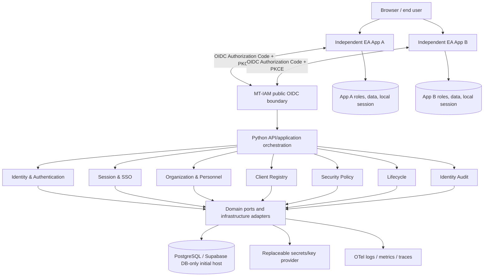

# MT-IAM Target System Architecture v0.5 — Python-first / Cloud-agnostic

**Status: DESIGN BASELINE / proposed detailed implementation; ADR-007 direction ACCEPTED; R3 tests NOT RUN.** 2026-11-13.
**Canonical:** this file supersedes physical/runtime assumptions in TARGET_ARCHITECTURE_v0.4.md; older files remain as decision history.

## Mission and boundaries
Centralize trusted identity, authentication, federation, personnel minimum directory, organizations, lifecycle, client registry and identity audit. Applications independently own admission, internal roles, business permissions, business data/logs and technology. An MT-IAM user is NOT automatically an authorized member of an application. Identity key is (issuer, sub), not email. No synchronous identity lookup required on every business request.

## Container/component view


## Layer policy
1. **Protocol/transport:** OIDC discovery, authorize, token, JWKS, optional UserInfo, logout/revocation when supported; FastAPI REST Admin/Directory APIs. Public protocol routes do not automatically follow `/api/v1` convention.
2. **Application:** use-case handlers, orchestrator, command/query boundaries, transaction scopes, idempotency and deadlines; business engine does not know HTTP specifics.
3. **Domain:** identity, personnel, organization, accounts, credential policy, session/client metadata, lifecycle invariants, domain events; no cloud SDK or direct SQL/HTTP.
4. **Ports:** repositories, clock, key provider, mail/notification, event publisher, observability; typed input/output/error contracts.
5. **Adapters:** SQLAlchemy/psycopg/PostgreSQL, OIDC implementation, secret providers, local/container files, HTTP clients, telemetry exporters.
6. **Deployment:** OCI image, Cloud Run initially; Linux Compose alternative; cloud adapters selected by configuration. Provider migration must preserve issuer/subject, key-verification continuity and client registrations.

## Primary library candidates and responsibilities (pin tested versions later)
| Concern | Candidate | Scope |
|---|---|---|
| HTTP | FastAPI, Uvicorn | ASGI routes, request/response, lifespan |
| Models/config | Pydantic, pydantic-settings | validation, env-based settings |
| PostgreSQL | SQLAlchemy, psycopg 3 | data access, transactions, driver |
| Schema change | Alembic | migration scripts and revision history, NOT DB connectivity |
| OIDC/crypto | evaluated maintained authorization-server component, Authlib/joserfc/cryptography as applicable | **selection pending security and conformance evaluation** |
| Password credentials | vetted Argon2 library if local passwords are in scope | password verification, no custom hashing |
| External calls | HTTPX | bounded connect/read/total timeouts, shared client |
| Async coordination | asyncio/AnyIO, contextlib | task grouping, cancellation, cleanup |
| Retries | tenacity (optional) | bounded retry for safe/idempotent calls only |
| Tests | pytest, HTTPX, testcontainers, hypothesis (as needed) | deterministic unit, ASGI, DB, property tests |
| Quality | Ruff, mypy, pip-audit | lint/type/dependency checks |
| Telemetry | structlog, OpenTelemetry | JSON logs, trace correlation, redaction |
| Dependency lock | uv/pyproject.toml or pip with pinned hashes | reproducibility |
| Paths | pathlib, importlib.resources, optional platformdirs | packaged read-only assets, temporary/cache locations |

## Engines & orchestration
- Domain engines: Identity, Authentication, SSO/Session, Organization, Client Registry, Policy, Lifecycle, Audit.
- Domain engines expose public interfaces only; NO cross-engine internal imports, global mutable singleton state or cyclic dependency.
- Orchestrator handles multi-step business use cases; do not funnel every trivial call through a central bottleneck.
- Secure operations requiring transactionally consistent DB changes use one unit-of-work when possible. External side effects use transactional outbox + idempotent consumer when reliability requires it.
- Concurrency: per-engine semaphores/quotas and global budgets, finite queue sizes, deadline propagation; never hold DB session over network I/O.
- Runtime and worker concurrency must be jointly bounded with max container instances and DB connection budget.

## Database/consistency
- PostgreSQL serves operational identity SSOT; migrations are versioned in Git. Secrets, private keys and actual personnel data never in public repository.
- Runtime DB access via least-privileged SQL role. Separate migration role. Runtime transaction pooling vs direct/session connection is a measured compatibility decision; prepared statements require explicit tests.
- Auth codes must be single-use atomically; session revocation and refresh-token reuse must reject replay under concurrent requests; expiry cannot depend only on a display-state column.
- Audit events for critical account, client and session changes must not silently disappear. Use transactional audit/outbox when required; define retention and privacy classification.
- Backups, restore, failover and RPO/RTO require evidence before production.

## Resource lifecycle contract
| Resource | Owner and scope | Cleanup/evidence |
|---|---|---|
| SQLAlchemy engine/pool | application lifespan per worker | dispose on shutdown; connections bounded |
| DB Session/UoW | request/use case | context manager, commit/rollback, close |
| HTTPX AsyncClient | lifespan per worker | aclose; limits/timeouts |
| Temp files | scoped task, under PathManager | TemporaryDirectory cleanup |
| Task group/background work | orchestration runtime | cancel, await, failure policy, durable queues for critical work |
| Locks/semaphores | bounded scope | try/finally or async context; contention metrics |
| Signing keys | key custody provider | no logs, scoped permissions, explicit rotation |

Cloud Run instance CPU lifecycle and shutdown impose limits: do not rely on untracked fire-and-forget work after a response. Never run Alembic on every instance startup.

## SSOT and file layout
```text
pyproject.toml / uv.lock             # reproducible dependencies
src/mt_iam/{domain,application,ports,adapters,api,bootstrap,engines}/
src/mt_iam/core/{config,paths,lifecycle,errors}.py
configs/{default,development,testing}.yaml   # non-secret defaults only
migrations/                         # Alembic revisions
tests/{unit,integration,contract,security,concurrency,portability}/
docs/{architecture,adr,domain,protocol,security,delivery,operations}/
```
Pydantic settings validate production config at startup; environment/secret provider overrides are explicit. PathManager never assumes current working directory; packaged resources read-only, ephemeral writes bounded; persistent files require storage adapter.

## Non-functional requirements — targets pending measurement/approval
- Workload planning assumption: 30k–50k HTTP requests/month; peak ~30 requests/minute; **not tested**.
- Define measurable SLO for sign-in availability, p95 login and token latency, max propagation of suspension, backup RPO/RTO, alerting ownership.
- Zero cost is NOT a production guarantee. Billing budget alerts do not enforce a hard spending cap.
- Collect privacy/legal/agency approvals before live police/personnel records.

## Deployment topology
- Initial: GitHub source -> CI checks -> versioned OCI image -> Cloud Run -> PostgreSQL (Supabase host only); replaceable secret provider and logs.
- Alternative: same OCI image -> Linux container host -> non-Supabase PostgreSQL; TLS, hostnames, secrets and storage adapters changed via config.
- Stable organization-controlled issuer domain is crucial; switching cloud host should not casually change `iss` or `sub`.
- Separate dev/test/prod environments, distinct secrets, low-privilege service accounts, deliberate migration job and verified rollback.

## Release gates / evidence
Architecture review: proposed. OIDC component comparison and protocol conformance: BLOCKED (not selected). Unit/API/DB/security/concurrency/portability/backup/load tests: NOT RUN. Privacy and operational signoff: BLOCKED. **Production release: BLOCKED.**

## Linked design artefacts
- [ADR-007](../adr/ADR-007_PYTHON_FIRST_PORTABLE_MODULAR_CORE.md)
- [Actors, use cases, API boundaries, states and sequences](SYSTEM_MODEL_v0.5.md)
- [Engineering, resource and testing standard](../delivery/ENGINEERING_VERIFICATION_STANDARD_v0.5.md)
- [Existing MT-ISP OIDC profile](../protocol/MT-ISP-002_OIDC_PROFILE_v0.2.md) — retained, reconcile during design review.

## Standards and references
- https://pages.nist.gov/800-63-4/
- https://openid.net/specs/openid-connect-core-1_0.html
- https://openid.net/specs/openid-connect-discovery-1_0.html
- https://www.rfc-editor.org/rfc/rfc9700.html
- https://www.rfc-editor.org/rfc/rfc7636.html
- https://owasp.org/www-project-application-security-verification-standard/
- https://cloud.google.com/run/docs/container-contract
- https://supabase.com/docs/guides/database/connecting-to-postgres

## POC-first verification and onboarding (2026-11-13)
The [Master POC Plan v1.0](../poc/MASTER_POC_PLAN_v1.0.md) governs architecture feasibility verification: 12 risk-aligned groups, 52 experiments, all NOT RUN at baseline. Teams shall begin at the [Handoff Playbook](../poc/POC_EXECUTION_AND_HANDOFF_v1.0.md) and pre-register criteria in the [POC Template](../poc/POC_SPEC_TEMPLATE_v1.0.md). No OIDC/library/cloud decision becomes production-approved merely because a prototype runs.
