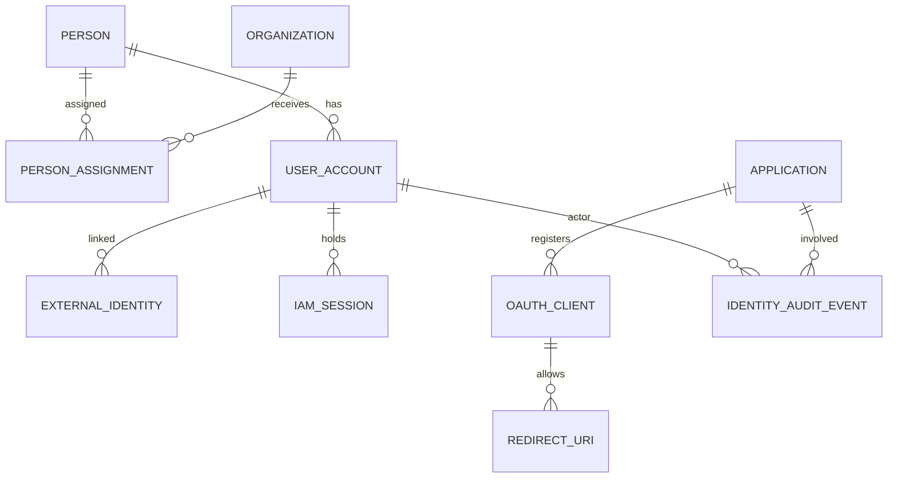

# MT-IAM Logical / Physical Data Model v0.2
Status: DRAFT schema proposal — **not applied to Supabase**. All personally identifying sample data must be synthetic.

## Separation of ownership
Identity and shared minimum personnel records are MT-IAM-owned SSOT. A separate HR source, when authoritative, supplies source-attributed updates. App admission, local roles/permissions and business records never belong here.

## Entity relationships

## Proposed tables and immutable identifiers
| Table | Key fields | Important constraints |
|---|---|---|
| persons | person_id uuid PK; display_name; legal_name optional; source_system; version; updated_at | No national ID as PK. Collect minimum necessary fields |
| organizations | organization_id uuid PK; parent_id FK; code unique scoped; name; status | Hierarchy checked for cycles |
| person_assignments | assignment_id uuid PK; person_id FK; organization_id FK; title; valid_from/to | Dated history; avoid destructive overwrites |
| user_accounts | user_id uuid PK; person_id nullable FK; status; created_at; disabled_at; version | A user may be external/non-personnel; status constrained |
| external_identities | identity_id uuid PK; user_id FK; issuer; subject; created_at | UNIQUE(issuer, subject), not email |
| applications | app_id text PK; display_name; owner_contact; status; contract_version | Trust registry ONLY, not user-app access rights |
| oauth_clients | client_id text PK; app_id FK; type; approved_scopes; status | Exact client metadata; no plaintext client secret |
| redirect_uris | client_id FK; uri; UNIQUE(client_id,uri) | Exact-match approved redirect URIs |
| iam_sessions | session_id uuid PK; user_id FK; created_at; expires_at; revoked_at; assurance | Store only hashed/opaque session identifiers; protected server-side |
| auth_events | event_id uuid PK; user_id nullable; client_id; outcome; created_at; request_id | No raw tokens or passwords |
| identity_audit_events | event_id uuid PK; actor_user_id; target_user_id; event_type; outcome; request_id; timestamp | Append-oriented, restricted |
| directory_change_log | change_id bigint PK; subject_type; subject_id; version; changed_at | Authorized incremental sync and purge policy |
| key_metadata | key_id; algorithm; status; not_before/after; created_at | References key custody; NEVER plaintext private keys in public repo |

## Index and integrity proposal
- UNIQUE(external_identities.issuer, external_identities.subject).
- Index user_accounts(status), person_assignments(person_id, valid_to), auth_events(created_at,client_id), identity_audit_events(timestamp,actor_user_id), directory_change_log(change_id).
- FK constraints with RESTRICT for irreversible deletion; explicit lifecycle retention/anonymization workflows.
- created_at/updated_at timestamptz UTC; use optimistic version increments when concurrent updates.
- Ensure account status transitions are audited; do not create IAM tables for app-specific role/permission matrices.

## Data classification and minimization
- PUBLIC: sanitized protocol documentation only.
- INTERNAL: application registry, aggregate metrics.
- CONFIDENTIAL: names, official contact info, employment details; protect at API layer.
- SECRET: password hashes, session secrets, signing private keys, database keys; dedicated controlled storage, never returned in directory APIs.
Schema and column-level RLS policies need separate review. **Supabase service-role credentials bypass RLS** and must remain backend-only with the smallest effective privileges possible.

## Migration and portability
- Use versioned SQL migrations, no manual production schema edits.
- PostgreSQL compatibility tested by export/restore to a second PostgreSQL instance.
- OIDC issuer URL and signing keys require separately controlled migration; database backup alone is insufficient for transparent client continuity.
- Record origin, changed_at, version for authoritative personnel attributes; conflict resolution is field-by-field.

## API projection (not whole row)
Authorized /identity/me may return user_id, display_name, organization_id, account_status, profile_version; app receives only scoped attributes. Other persons need distinct directory scope and audit.

## Unresolved decisions
Actual personnel schema owner, HR import, legal retention, exact password/credential custody, session protocol engine, email/phone verification requirements; none are approved merely by this ERD.
