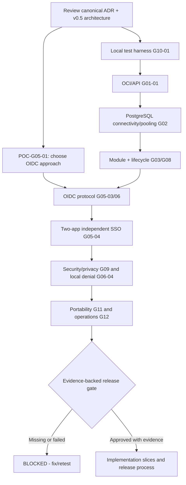

# MT-IAM POC Execution & Team Handoff Playbook v1.0

**Status: HANDOFF BASELINE / tests NOT RUN. Risk R3.** 2026-11-13.
Start at [README](../../README.md) -> [Target Architecture v0.5](../architecture/TARGET_ARCHITECTURE_v0.5_PYTHON_FIRST.md) -> [Master POC Registry](MASTER_POC_PLAN_v1.0.md) -> [System Models](../architecture/SYSTEM_MODEL_v0.5.md). See [POC template](POC_SPEC_TEMPLATE_v1.0.md).

## 30-second team alignment
**Objective:** Create a secure, testable, vendor-independent MT-IAM identity/SSO platform for multiple independently owned EA applications. Python domain/core, OCI runtime (Cloud Run initially), Supabase as PostgreSQL host **only**, published OIDC/OAuth and REST contracts. Reuse well-maintained OSS; do not handwrite cryptography. Clients own their local access rights, business data, and sessions.

**Why POC-first:** Prevent sunk costs in OIDC incompatibility, database pooler behavior, resource leaks and vendor coupling. Do not build the entire identity product while these choices are speculative.

**Current reality:** Architectural documents exist; runtime, conformance, integration, security and portability test evidence: **NOT RUN**. OIDC selection and production: **BLOCKED**. Existing GAS-first v0.4 and POC-03 files are historical; ADR-007 and v0.5 are current.

## Team responsibilities (roles, not assumed named people)
| Role | Accountable deliverables |
|---|---|
| Architecture Lead | boundaries, ADRs, sequencing, design SSOT, risk acceptance |
| Identity/OIDC Security Engineer | authorization server evaluation, standards profile, threat/negative tests |
| Python/Backend Engineer | minimal modular code, DI, API/engine contracts, lifecycle |
| Data Engineer | PostgreSQL roles, migrations, pooler/transactions, backup/restore |
| SRE/Cloud Engineer | reproducible OCI deployment, health, limits, secrets, cost telemetry |
| QA/Test Engineer | test matrix, falsification, evidence, traceability, CI gates |
| Privacy/Legal Reviewer | real data authorization, retention and compliance review |
One individual may fulfill multiple engineering roles, but privileged action approval/review must not be silently self-approved in production.

## Single-source-of-truth boundaries
| Asset | SSOT |
|---|---|
| Architecture/version/ADR/POC specs | GitHub versioned Markdown, canonical files linked in README |
| Source code, test code, dependency locks, deployment manifests | GitHub at reviewed commit |
| Operational identity/personnel/client records | PostgreSQL, access-controlled; not GitHub |
| Keys/passwords/secrets | scoped secret provider, never repository |
| Test outcomes | immutable-ish commit-referenced evidence docs in repo, sanitized artifacts |
| Live operations/cost | cloud monitoring/billing reports, never hardcoded guessed numbers |

## Workflow for each POC
1. **Select** an unblocked POC ID from MASTER_POC_PLAN. Declare owner, reviewer, prerequisites, affected UC/API/ADR and risk R3.
2. **Pre-register test plan** using POC_SPEC_TEMPLATE: falsifiable hypothesis, representative environment, baseline, test cases (happy/negative/failure), measurable acceptance, maximum spend and stopping criteria.
3. **Minimize cost and attack surface:** run deterministic local experiments first, synthetic identities only, bounded resources, no public real personnel endpoints.
4. **Build smallest test harness** via branches/PRs and interface-first modules. Pin dependencies and identify license/security provenance.
5. **Execute** exact commands and capture revision, environment, timestamps, sanitized evidence; note real cost and DB/CPU/memory/connection observations.
6. **Review** for false positives, missing data, repeatability, security and privacy. Set PASS/FAIL/BLOCKED/NOT RUN, never conflate IN PROGRESS with PASS.
7. **Decide** via ADR: accept architecture, change library/driver, redesign contract, or abandon approach. Update Registry result and downstream dependency impact.
8. **Handoff** with test links, unresolved risks, next experiment and explicit resource cleanup; do not deploy/release without appropriate authorization.

## Evidence naming and test traceability
- Experiment: `POC-G05-03`.
- Use case: `UC-AUTH-001`.
- Sequence: `SEQ-001`; state machine: `STM-CODE`; rule: `BR-001`.
- Tests: `T-POC-G05-03-001`, `-002`, etc.
- Results: `docs/poc/evidence/POC-G05-03/RESULT.md` and bounded, redacted attachments.
- POC outcome must contain one owner, reviewer, source commit, exact command, positive and negative result, architecture action.
- For external services capture actual project ID only when necessary; never copy billing identifiers, cards, personal information or access tokens into a public repo.

## Technical sequence and gating

This graph shows critical dependencies, not an obligation to do every POC serially.

## First three work packages
### WP-01: OIDC feasibility research (no production auth code)
- Compare at least 2 viable maintained OIDC authorization-server implementations against: Python integration strategy, license, current maintenance, security controls, discovery/JWKS/code+PKCE, key rotation, metadata/logout/revocation, migration burden, portability and conformance path.
- Deliver comparison matrix with authoritative URLs, risk register and a reasoned shortlist; status remains BLOCKED until tested.

### WP-02: cheapest reproducible runtime
- Implement a minimal synthetic `/health/live` API with FastAPI factory and lifespan, automated pytest and Ruff. Build once with OCI; run locally then on a bounded Cloud Run test revision.
- Verify SIGTERM cleanup, no application-level hard dependency on Google SDK and no secrets in container image.

### WP-03: database adapter and pooling
- Experiment with disposable PostgreSQL and Supabase test DB only after network/secret approval. Use psycopg and SQLAlchemy; define least privilege and bounded connection budget.
- Validate SQLAlchemy pool choice (including NullPool when appropriate), prepared statement and pooler compatibility; explicit Alembic upgrade/recovery test via separate job.
- Re-run against non-Supabase PostgreSQL for initial portability evidence.

## Safety, cost and stop rules
- No production credentials, staff records or real policy decisions in PoCs. Require explicit owner approval before any public-facing auth endpoint or cloud resource with material cost.
- Prefer local Docker/PostgreSQL when possible; resource settings in cloud proposals are hypotheses, not guarantees. Cloud Run min instances = 0 for trial, bounded max instances, remove unused services/images and validate pricing.
- Cost checkpoint: before cloud resource creation, capture service pricing and anticipated request/compute/storage/network/log consumption; after POC, reconcile billing. A budget alert is not an actual cap.
- Stop and mark BLOCKED for unknown OIDC library security/maintainer status, secret leakage, unexpected billing, unsafe redirect/account exposure, or no credible rollback.
- No production deployment until secure sessions, protocol conformance, rate limits, key custody, independent app access, personal-data controls, backup/restore, capacity and incident procedures verified.

## Required handoff note after each experiment
```text
Project: MT-IAM | canonical architecture v0.5 | ADR-007
Experiment ID / linked UC and ADR:
Owner / reviewer:
Repository revision / branch:
Environment and exact run command:
What passed (evidence links):
What failed / blocked (evidence links):
Resources created, cleanup completed:
Billing actuals and remaining risks:
Decision / impact on adjacent engines:
Next safe POC and its prerequisites:
```

## References
- https://openid.net/specs/openid-connect-core-1_0.html
- https://www.rfc-editor.org/rfc/rfc9700.html
- https://pages.nist.gov/800-63-4/
- https://cloud.google.com/run/docs/container-contract
- https://supabase.com/docs/guides/database/connecting-to-postgres
